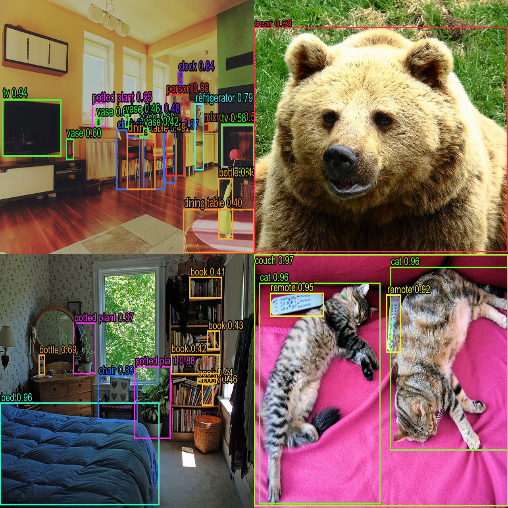
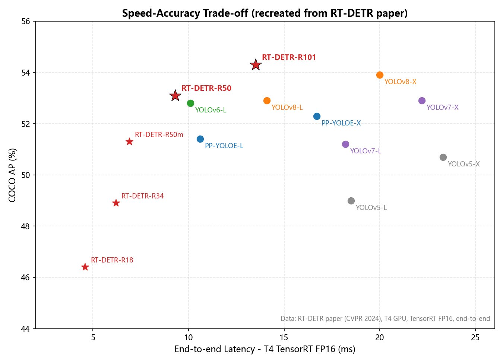
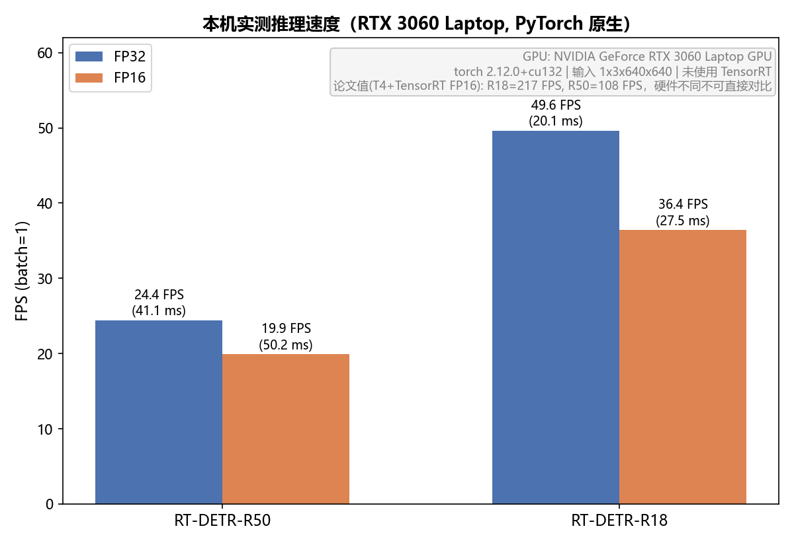
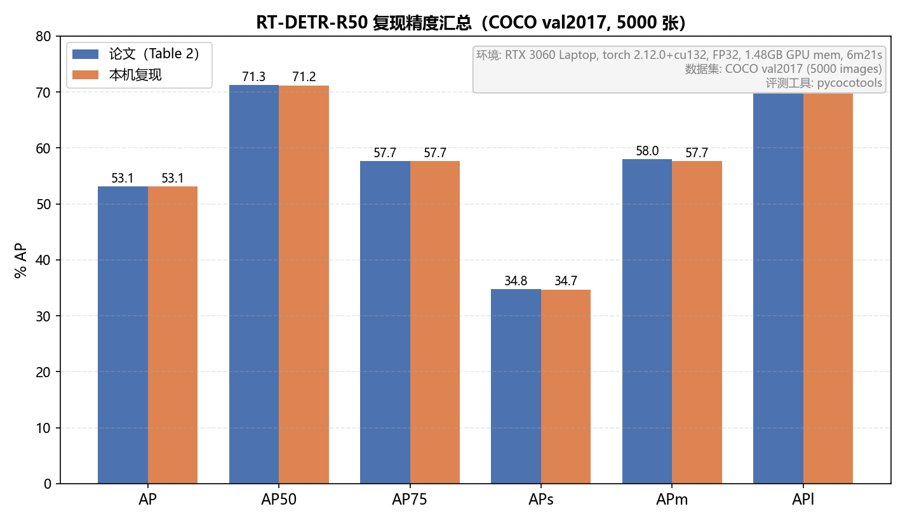

# RT-DETR 复现

复现对象：**RT-DETR: DETRs Beat YOLOs on Real-time Object Detection**（CVPR 2024，百度）

官方仓库：https://github.com/lyuwenyu/RT-DETR

## 复现内容

- 官方 RT-DETR-R50 权重在 COCO val2017（5000 张）上的全量评测：**AP 53.1**，与论文 Table 2 报告值一致
- RT-DETR-R50 / R18 本机 FPS 实测（PyTorch 原生推理，未使用 TensorRT）
- 检测结果可视化、论文 Figure 1 风格的速度-精度对比图、复现指标对表图

## 目录结构

```
rtdetr-repro/
├── scripts/    复现脚本（推理可视化、FPS 基准、绘图）
├── patches/    官方代码的兼容补丁（适配新版 torchvision）
├── figures/    结果图与测速、评测数据（JSON）
├── results/    检测结果图与 JSON 预测
├── eval/       COCO 评测日志
├── images/     示例输入图（COCO val2017 样例）
└── README.md
```

## 环境

- Windows，Python 3.10
- PyTorch 2.12.0 + CUDA，torchvision 0.27
- NVIDIA RTX 3060 Laptop（6GB 显存）
- 额外依赖：pycocotools（评测）、matplotlib（绘图）

## 权重下载（官方）

- RT-DETR-R50：https://github.com/lyuwenyu/storage/releases/download/v0.1/rtdetr_r50vd_6x_coco_from_paddle.pth
- RT-DETR-R18：https://github.com/lyuwenyu/storage/releases/download/v0.1/rtdetr_r18vd_dec3_6x_coco_from_paddle.pth

## 复现步骤

1. 克隆官方仓库，并应用兼容补丁（官方代码基于 torch 2.0.1 / torchvision 0.15 编写，新版 torchvision 需要）：

```bash
git clone https://github.com/lyuwenyu/RT-DETR.git
cd RT-DETR
git apply /path/to/patches/rtdetr-pytorch-compat.patch
```

补丁内容：`datapoints → tv_tensors`（`BoundingBox → BoundingBoxes`）、`spatial_size → canvas_size`、旧变换 `ToImageTensor / ConvertDtype / SanitizeBoundingBox` 的等价兼容实现。

2. 准备数据（COCO val2017 图片与标注），修改 `rtdetr_pytorch/configs/dataset/coco_detection.yml` 中 `val_dataloader` 的 `img_folder` 与 `ann_file` 路径。

3. 全量评测：

```bash
cd rtdetr_pytorch
python tools/train.py -c configs/rtdetr/rtdetr_r50vd_6x_coco.yml \
  -r /path/to/rtdetr_r50vd_6x_coco_from_paddle.pth --test-only
```

4. 推理与可视化（脚本通过环境变量 `RTDETR_REPO` 定位官方代码，默认为当前目录下的 `rtdetr_pytorch`）：

```bash
python scripts/repro_infer.py \
  --config /path/to/rtdetr_pytorch/configs/rtdetr/rtdetr_r50vd_6x_coco.yml \
  --ckpt /path/to/rtdetr_r50vd_6x_coco_from_paddle.pth \
  --images images --out results --grid figures/fig3_rtdetr_detections_grid.jpg
```

5. 测速与绘图：

```bash
python scripts/benchmark_fps.py \
  --r50-config /path/to/rtdetr_r50vd_6x_coco.yml --r50-ckpt /path/to/rtdetr_r50vd_6x_coco_from_paddle.pth \
  --r18-config /path/to/rtdetr_r18vd_6x_coco.yml --r18-ckpt /path/to/rtdetr_r18vd_dec3_6x_coco_from_paddle.pth \
  --out figures/benchmark_local.json

python scripts/make_figures.py
python scripts/make_fig4_final.py
```

## 复现结果

### COCO val2017 全量评测（RT-DETR-R50）

| 指标 | 论文 Table 2 | 本机复现 |
| --- | --- | --- |
| AP | 53.1 | 53.1 |
| AP50 | 71.3 | 71.2 |
| AP75 | 57.7 | 57.7 |
| APs | 34.8 | 34.7 |
| APm | 58.0 | 57.7 |
| APl | 70.0 | 70.1 |

评测耗时 6 分 21 秒（5000 张，FP32，峰值显存约 1.5GB）。原始日志见 `eval/rtdetr_r50vd_coco_val2017_log.txt`。

### 本机速度实测（PyTorch，batch=1，640×640）

| 模型 | FP32 |
| --- | --- |
| RT-DETR-R50 | 24.4 FPS（41.1 ms） |
| RT-DETR-R18 | 49.6 FPS（20.1 ms） |

注：论文的 108 / 217 FPS 基于 T4 + TensorRT FP16 端到端测试，硬件与推理后端不同，数值不可直接对比。

### 结果图








